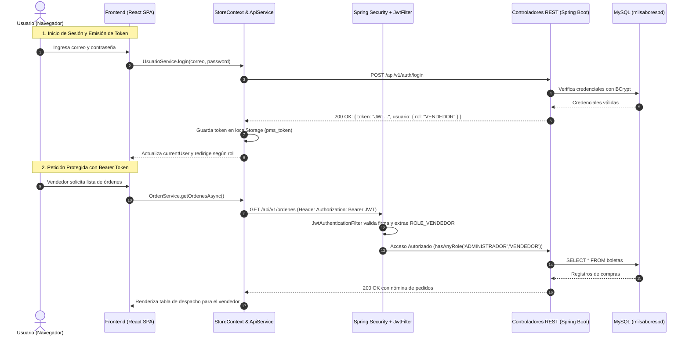

# Documentación APIs e Integración - Pastelería Mil Sabores

**Título:** Documentación de API RESTful e Integración Fullstack  
**Proyecto:** Pastelería Mil Sabores  
**Versión del Documento:** 1.0  
**Fecha de Creación:** 12/11/2026  
**Asignatura:** DSY1104 - Desarrollo Fullstack II (Evaluación Parcial 3)  
**Institución:** Duoc UC  

---

## 1. Descripción General

Este documento proporciona una descripción exhaustiva de la arquitectura de servicios web REST diseñados e implementados en **Java Spring Boot 3**, que gestionan la lógica de negocio, catálogo de productos, órdenes de compra y administración de usuarios de la tienda online **Pastelería Mil Sabores**.

Está dirigido a desarrolladores, arquitectos de software y evaluadores técnicos que interactúan con el backend y analizan la comunicación con el frontend en React. La solución incluye:
- Autenticación y autorización basada en tokens **JWT (JSON Web Tokens)** sin estado (Stateless).
- Segregación de privilegios en tres roles (**Administrador**, **Vendedor** y **Cliente**).
- Versionado formal de rutas bajo el prefijo `/api/v1/`.
- Documentación interactiva mediante **OpenAPI 3 / Swagger UI**.

---

## 2. Información General

| Parámetro | Detalle de Conexión |
| :--- | :--- |
| **URL Base de la API REST** | `http://localhost:9091/api/v1` (y alias retrocompatible `http://localhost:9091/api`) |
| **URL Swagger UI** | `http://localhost:9091/swagger-ui.html` |
| **URL Especificación OpenAPI JSON** | `http://localhost:9091/v3/api-docs` |
| **Motor de Base de Datos** | MySQL 8.0 (`jdbc:mysql://localhost:3306/milsaboresbd`) |
| **Mecanismo de Autenticación** | HTTP Header `Authorization: Bearer <token_jwt>` |
| **Formato de Carga Útil** | `application/json` (UTF-8) |

---

## 3. Documentación de Endpoints

### 3.1. Módulo de Autenticación y Seguridad (`/api/v1/auth`)

#### POST `/api/v1/auth/login`
- **Descripción:** Valida credenciales de acceso contra hashes almacenados en la base de datos (BCrypt) y emite un token JWT con vigencia de 24 horas que contiene los claims del usuario (id, nombre, correo, rol y beneficios).
- **Método HTTP:** `POST`
- **Tipo de API:** Pública
- **Requiere Autenticación:** No
- **Datos de Entrada (JSON):**
  ```json
  {
    "correo": "admin@milsabores.cl",
    "password": "Admin1234"
  }
  ```
- **Respuestas:**
  - `200 OK`: Autenticación exitosa. Retorna token JWT y perfil sanitizado (sin contraseña).
    ```json
    {
      "token": "eyJhbGciOiJIUzI1NiIsInR5cCI6IkpXVCJ9...",
      "tipoToken": "Bearer",
      "usuario": {
        "id": 1,
        "nombre": "Administrador General",
        "correo": "admin@milsabores.cl",
        "rol": "ADMINISTRADOR",
        "beneficios": ["ADMIN"]
      }
    }
    ```
  - `401 UNAUTHORIZED`: Credenciales incorrectas.
  - `400 BAD REQUEST`: Campos obligatorios ausentes o vacíos.

#### POST `/api/v1/auth/registro`
- **Descripción:** Registra un nuevo usuario en la base de datos. Encripta la contraseña mediante BCrypt, calcula automáticamente los beneficios comerciales por edad (>50 años recibe `MAYOR_50`) o cupón promocional (`FELICES50`), asigna el rol correspondiente y entrega la sesión iniciada con token JWT.
- **Método HTTP:** `POST`
- **Tipo de API:** Pública
- **Requiere Autenticación:** No
- **Datos de Entrada (JSON):**
  ```json
  {
    "nombre": "Sofía González",
    "correo": "sofia@milsabores.cl",
    "password": "PasswordSegura123",
    "fechaNacimiento": "1995-10-20",
    "codigoPromo": "FELICES50"
  }
  ```
- **Respuestas:**
  - `201 CREATED`: Cuenta creada exitosamente con token emitido.
  - `400 BAD REQUEST`: Fecha de nacimiento futura o datos incompletos.
  - `409 CONFLICT`: El correo ya se encuentra registrado.

#### POST `/api/v1/auth/refresh`
- **Descripción:** Permite a clientes con un token JWT vigente y legítimo solicitar su renovación antes de la expiración sin requerir reingresar credenciales (IE3.3.1.b).
- **Método HTTP:** `POST`
- **Tipo de API:** Privada
- **Requiere Autenticación:** Sí (Token previo)
- **Datos de Entrada:** `{"token": "eyJhbGciOiJIUzI1NiIs..."}`
- **Respuestas:** `200 OK` (Nuevo token) o `400 BAD REQUEST` (Token expirado/inválido).

---

### 3.2. Módulo de Catálogo de Productos (`/api/v1/productos`)

#### GET `/api/v1/productos`
- **Descripción:** Retorna el catálogo completo de tortas y postres, incluyendo precios base, existencias en inventario y descuentos promocionales vigentes.
- **Método HTTP:** `GET`
- **Tipo de API:** Pública (Permitido para Clientes, Vendedores y Administradores).
- **Requiere Autenticación:** No
- **Respuestas:** `200 OK` (Array de productos en JSON).

#### GET `/api/v1/productos/{id}`
- **Descripción:** Consulta el detalle específico de un producto por su identificador primario.
- **Método HTTP:** `GET`
- **Tipo de API:** Pública (Utilizada por Clientes y Vendedores para ver detalles técnicos e ingredientes).
- **Respuestas:** `200 OK` (Producto localizado) o `404 NOT FOUND`.

#### POST `/api/v1/productos`
- **Descripción:** Da de alta una nueva torta o postre en el inventario.
- **Método HTTP:** `POST`
- **Tipo de API:** Privada
- **Requiere Autenticación:** Sí
- **Roles Permitidos:** Exclusivo `ROLE_ADMINISTRADOR`
- **Datos de Entrada (JSON):**
  ```json
  {
    "nombre": "Torta Tres Leches Casera",
    "categoria": "Tortas Circulares",
    "precio": 38000.0,
    "stock": 10,
    "descripcion": "Bizcocho tradicional remojado en tres leches con merengue dorado.",
    "imagen": "https://images.unsplash.com/photo-1578985545062-69928b1d9587?w=600",
    "enOferta": false,
    "descuento": 0.0
  }
  ```
- **Respuestas:**
  - `201 CREATED`: Producto registrado.
  - `403 FORBIDDEN`: Acceso denegado si quien intenta la acción es Vendedor o Cliente.
  - `400 BAD REQUEST`: Precio o stock negativos.

#### PUT `/api/v1/productos/{id}`
- **Descripción:** Modifica los valores de un producto existente (precio, stock, oferta).
- **Método HTTP:** `PUT`
- **Tipo de API:** Privada
- **Roles Permitidos:** Exclusivo `ROLE_ADMINISTRADOR`
- **Respuestas:** `200 OK` o `404 NOT FOUND` / `403 FORBIDDEN`.

#### DELETE `/api/v1/productos/{id}`
- **Descripción:** Elimina físicamente un producto del catálogo.
- **Método HTTP:** `DELETE`
- **Tipo de API:** Privada
- **Roles Permitidos:** Exclusivo `ROLE_ADMINISTRADOR`
- **Respuestas:** `204 NO CONTENT` o `404 NOT FOUND` / `403 FORBIDDEN`.

---

### 3.3. Módulo de Categorías (`/api/v1/categorias`)

- **GET `/api/v1/categorias`:** Consulta de las familias de productos (Tortas Cuadradas, Tortas Circulares, Sin Azúcar, Sin Gluten). Acceso público.
- **POST `/api/v1/categorias`:** Creación de nueva categoría. Privado (`ROLE_ADMINISTRADOR`).
- **DELETE `/api/v1/categorias/{id}`:** Eliminación de categoría. Privado (`ROLE_ADMINISTRADOR`).

---

### 3.4. Módulo de Órdenes y Boletas de Compra (`/api/v1/ordenes`)

Corresponde a la tabla `boletas` y `detalle_boleta` del modelo relacional propuesto en el **Anexo 1**.

#### POST `/api/v1/ordenes`
- **Descripción:** Registra una transacción de compra emitida por un cliente o usuario en checkout. Descuenta de forma transaccional el inventario de bodega de cada producto comprado para evitar sobre-venta.
- **Método HTTP:** `POST`
- **Tipo de API:** Pública (Permite emitir compra a clientes y anónimos tras checkout).
- **Requiere Autenticación:** No (Para facilitar compra a consumidores registrados o de paso).
- **Datos de Entrada (JSON):**
  ```json
  {
    "clienteNombre": "Juan Pérez",
    "clienteCorreo": "cliente@milsabores.cl",
    "direccionCalle": "Av. Providencia 1234, Dpto 502",
    "direccionComuna": "Providencia",
    "subtotal": 87900.0,
    "descuento": 43950.0,
    "total": 43950.0,
    "items": [
      {
        "productoId": 2,
        "nombre": "Torta Circular de Manjar",
        "precio": 35700.0,
        "cantidad": 1
      },
      {
        "productoId": 4,
        "nombre": "Brownie Sin Gluten",
        "precio": 3600.0,
        "cantidad": 2
      }
    ]
  }
  ```
- **Respuestas:**
  - `201 CREATED`: Boleta guardada exitosamente y stock rebajado en base de datos.
  - `400 BAD REQUEST`: Carrito vacío o total no válido.

#### GET `/api/v1/ordenes`
- **Descripción:** Lista el historial general de pedidos para despacho y ventas.
- **Método HTTP:** `GET`
- **Tipo de API:** Privada
- **Roles Permitidos:** `ROLE_ADMINISTRADOR` y `ROLE_VENDEDOR`
- **Respuestas:**
  - `200 OK`: Lista de boletas con su detalle de ítems.
  - `401 UNAUTHORIZED`: Si no se proporciona token Bearer.
  - `403 FORBIDDEN`: Si un cliente común intenta consultar la nómina completa de pedidos.

#### GET `/api/v1/ordenes/{id}`
- **Descripción:** Recupera una boleta específica con su lista de productos adquiridos.
- **Método HTTP:** `GET`
- **Roles Permitidos:** `ROLE_ADMINISTRADOR` y `ROLE_VENDEDOR`
- **Respuestas:** `200 OK` o `404 NOT FOUND`.

---

### 3.5. Módulo de Gestión de Usuarios (`/api/v1/usuarios`)

- **GET `/api/v1/usuarios`:** Lista de usuarios registrados. Privado (`ROLE_ADMINISTRADOR`).
- **GET `/api/v1/usuarios/{id}`:** Consulta de usuario por ID. Privado (`ROLE_ADMINISTRADOR`).
- **POST `/api/v1/usuarios`:** Creación directa de usuarios con asignación explícita de rol (ADMINISTRADOR, VENDEDOR o CLIENTE). Privado (`ROLE_ADMINISTRADOR`).
- **PUT `/api/v1/usuarios/{id}`:** Modificación de perfil de usuario. Privado (`ROLE_ADMINISTRADOR`).
- **DELETE `/api/v1/usuarios/{id}`:** Baja de usuario. Privado (`ROLE_ADMINISTRADOR`).

---

## 4. Integración con el Frontend (Verificación de Entrega)

### 4.1. Arquitectura y Flujo de Comunicación Fullstack



### 4.2. Inyección Automática del Token JWT en las Peticiones del Frontend

En el archivo `frontend/src/services/api.js`, el cliente HTTP centralizado intercepta cada llamada e inyecta la cabecera correspondiente:

```javascript
const request = async (ruta, opciones = {}) => {
  const token = localStorage.getItem('pms_token');
  const headers = {
    'Content-Type': 'application/json',
    ...(opciones.headers || {})
  };

  if (token) {
    headers['Authorization'] = `Bearer ${token}`;
  }

  const res = await fetch(`${BASE_URL}${ruta}`, { ...opciones, headers });
  if (!res.ok) {
    const err = new Error(`HTTP ${res.status}`);
    err.status = res.status;
    if (res.status === 401) {
      localStorage.removeItem('pms_token');
    }
    throw err;
  }
  return res.status === 204 ? null : res.json();
};
```

---

### 4.3. Verificación Visual de Respuestas de la API

A continuación se presentan las evidencias visuales del comportamiento de la interfaz de usuario en el frontend ante solicitudes exitosas y situaciones de excepción controladas por la API REST:

#### Evidencia 1: Solicitud Exitosa de Catálogo y Consulta de Detalles
**Figura 5 del Manual de Usuario**  
*Solicitud GET /api/v1/productos desde el Frontend*  
El componente `Home.jsx` ejecuta `ProductoService.getProductos()` al montarse. La API REST responde con código HTTP 200 y el arreglo JSON de productos. La interfaz renderiza las tarjetas con fotos, precios y descuentos promocionales aplicados sin demora perceptible.

#### Evidencia 2: Solicitud Exitosa de Inicio de Sesión y Redirección
**Figura 1 del Manual de Usuario**  
*Solicitud POST /api/v1/auth/login con Generación de JWT*  
Al enviar las credenciales, el backend valida la clave contra BCrypt, emite el token JWT y responde con HTTP 200. El frontend almacena el token en `localStorage` bajo la clave `pms_token`, actualiza el estado global de `StoreContext` y redirige al panel correspondiente al rol autenticado.

#### Evidencia 3: Emisión Exitosa de Boleta y Descuento de Stock
**Figura 6 y Figura 4 del Manual de Usuario**  
*Solicitud POST /api/v1/ordenes al Completar el Checkout*  
Al confirmar la compra en el carrito, se envían los ítems y datos de entrega. La API REST genera la boleta en la base de datos (HTTP 201 Created), actualiza el stock de existencias físicas y el frontend abre la boleta oficial detallando los artículos y rebajas aplicadas.

#### Evidencia 4: Manejo de Error HTTP 401 (No Autorizado)
Si un usuario intenta consumir endpoints protegidos sin enviar la cabecera `Authorization: Bearer <token>` o con un token alterado/expirado, la API REST retorna:
```json
{
  "status": 401,
  "error": "No autorizado",
  "mensaje": "Se requiere token JWT valido para acceder a este recurso."
}
```
El frontend captura el error con status 401, remueve automáticamente cualquier residuo de sesión en `localStorage` y orienta al usuario a iniciar sesión nuevamente.

#### Evidencia 5: Manejo de Error HTTP 403 (Acceso Denegado por Rol)
**Figura 7 del Manual de Usuario**  
*Respuesta HTTP 403 al Intentar Operaciones No Permitidas*  
Cuando un usuario con rol `CLIENTE` o `VENDEDOR` intenta invocar endpoints administrativos (por ejemplo crear un producto con `POST /api/v1/productos` o borrar una categoría), Spring Security intercepta la petición antes de llegar al controlador y devuelve:
```json
{
  "status": 403,
  "error": "Acceso denegado",
  "mensaje": "Su rol no posee permisos suficientes para esta operacion."
}
```
En el frontend, la interfaz bloquea el formulario y muestra la alerta informativa de la Figura 7.

#### Evidencia 6: Manejo de Conflicto HTTP 409 (Correo Duplicado en Registro)
Al intentar registrar una cuenta con un correo que ya existe en la tabla `usuarios`, el backend arroja HTTP 409 Conflict con el mensaje:
`"Ya existe una cuenta con ese correo"`
El formulario de registro despliega una alerta roja indicando: *"Ya existe una cuenta con ese correo"*, impidiendo la duplicidad de registros y preservando la integridad de datos.

