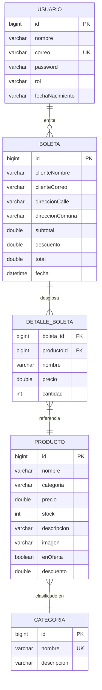
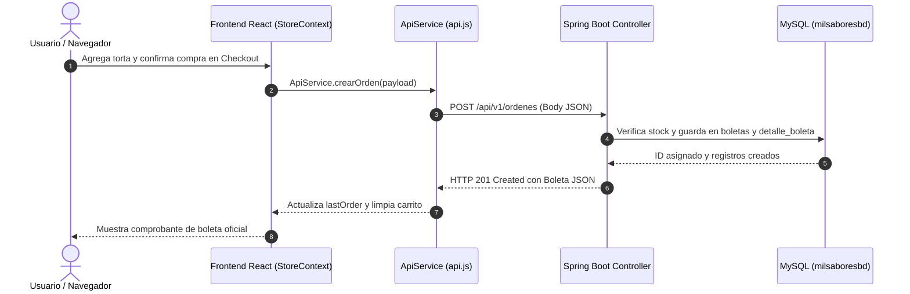

# Documento de Integración - Pastelería Mil Sabores

**Asignatura:** DSY1104 - Desarrollo Fullstack II  
**Evaluación:** Evaluación Parcial N° 3 (Integrando backend y frontend a la tienda online)  
**Proyecto:** Pastelería Mil Sabores  
**Documento Requerido Oficial:** *Documento de integración* (según pauta página 4)  
**Institución:** Duoc UC - Escuela de Informática y Telecomunicaciones  
**Fecha:** 16/11/2026  

---

## Índice del Documento
1. [Punto 1: Conexión a Base de Datos, Lógica de Negocio y Modelos de Datos (IE3.1.1 / IE3.1.2)](#1-conexión-a-base-de-datos-lógica-de-negocio-y-modelos-de-datos)
2. [Punto 2: Implementación de API REST en Spring Boot, CRUD y Swagger (IE3.2.1 / IE3.2.3)](#2-servicios-de-api-rest-en-spring-boot-crud-y-swagger)
3. [Punto 3: Integración y Flujo de Comunicación Backend-Frontend (IE3.2.2 / IE3.2.4)](#3-integración-y-comunicación-backend-frontend)
4. [Punto 4: Autenticación Segura con Roles y Tokens JWT (IE3.3.1 / IE3.3.4)](#4-autenticación-con-roles-y-tokens-jwt)
5. [Punto 5: Gestión y Persistencia de Sesión en el Frontend (IE3.3.2 / IE3.3.5)](#5-gestión-de-sesiones-y-persistencia-en-frontend)
6. [Punto 6: Restricciones de Acceso a Funcionalidades por Rol (IE3.3.3 / IE3.3.6)](#6-restricciones-de-acceso-a-funcionalidades-en-el-frontend)
7. [Matriz de Cumplimiento de la Rúbrica de Evaluación](#7-matriz-de-cumplimiento-de-la-rúbrica-de-evaluación)

---

## 1. Conexión a Base de Datos, Lógica de Negocio y Modelos de Datos

### 1.a. Confirmación de Conexión y Modelo de Datos según Requerimientos
El backend se encuentra conectado a una base de datos relacional **MySQL 8.0** denominada `milsaboresbd` a través de **Spring Data JPA** e **Hibernate** como motor ORM. La configuración de conexión está formalizada en `backend/src/main/resources/application.properties`:
```properties
spring.datasource.url=jdbc:mysql://localhost:3306/milsaboresbd?createDatabaseIfNotExist=true&useSSL=false&serverTimezone=UTC&allowPublicKeyRetrieval=true
spring.datasource.driver-class-name=com.mysql.cj.jdbc.Driver
spring.datasource.username=${DB_USER:root}
spring.datasource.password=${DB_PASSWORD:}
spring.jpa.hibernate.ddl-auto=update
```
Para contingencia en entornos de testeo continuo o cuando el motor MySQL local no esté encendido, el backend incluye el conector H2 en memoria.

#### Modelo de Datos de la Pastelería:
El modelo de datos refleja fielmente los requerimientos de la pastelería y la propuesta relacional del caso:
- **`Usuario` (`usuarios`)**: Gestiona la identidad de clientes, vendedores y administradores (`id`, `nombre`, `correo` único, `password` con hash BCrypt protegido como `WRITE_ONLY`, `rol`, `fechaNacimiento`, `beneficios`).
- **`Orden` (`boletas`)**: Representa el pedido de compra del cliente (`id`, `clienteNombre`, `clienteCorreo`, `direccionCalle`, `direccionComuna`, `subtotal`, `descuento`, `total`, `fecha`).
- **`ItemOrden` (`detalle_boleta`)**: Elemento embebido que desglosa los productos adquiridos en cada orden (`productoId`, `nombre`, `precio`, `cantidad`).
- **`Producto` (`productos`)**: Catálogo de tortas y postres (`id`, `nombre`, `categoria`, `precio`, `stock`, `descripcion`, `imagen`, `enOferta`, `descuento`).
- **`Categoria` (`categorias`)**: Clasificación comercial (`id`, `nombre` único, `descripcion`).



### 1.b. Lógica de Negocio Implementada
La capa de servicios (`OrdenService`, `ProductoService`, `UsuarioController`) resuelve las siguientes reglas de negocio del cliente:
1. **Control de Inventario y Prevención de Sobre-venta:** Al confirmarse un pedido, `OrdenService.registrarOrden()` se ejecuta bajo una transacción `@Transactional`. Por cada ítem comprado, consulta el producto y descuenta físicamente el stock en MySQL (`Math.max(0, stockActual - cantidadComprada)`), evitando discrepancias de bodega.
2. **Cálculo Automatizado de Beneficios Comerciales:**
   - **Adulto Mayor (`MAYOR_50`):** Al registrarse un usuario, el backend calcula la edad exacta mediante `Period.between(nacimiento, LocalDate.now()).getYears()`. Si supera los 50 años, se le asigna de forma automática el beneficio de **50% de descuento vitalicio**.
   - **Cupón de Bienvenida (`FELICES50`):** Si ingresa el código `FELICES50`, se le asigna un **10% de descuento**.
   - **Regla de No Acumulación:** En la liquidación del carrito, el sistema compara ambos beneficios y aplica el de mayor ahorro para el cliente sin acumular rebajas de forma duplicada.
3. **Validación de Ofertas por Producto:** Cada producto puede estar marcado con `enOferta = true` y un porcentaje entre 1% y 99%, aplicándose en el subtotal unitario.

### 1.c. Descripción del Desarrollo Backend
Se utilizó una arquitectura en capas:
- **`model`**: Entidades JPA con anotaciones de validación, constructores y métodos de acceso seguros.
- **`repository`**: Interfaces que extienden `JpaRepository<T, ID>` permitiendo consultas optimizadas (`findByCorreoIgnoreCase`, `existsById`).
- **`service`**: Lógica transaccional pura, desacoplada de la capa web.
- **`controller`**: Controladores REST anotados con `@RestController`, con gestión de códigos de estado HTTP (200, 201, 204, 400, 401, 403, 404, 409).
- **`config / security`**: Inicialización idempotente de datos (`DatosIniciales.java`), CORS, encriptación BCrypt y filtros JWT.

---

## 2. Servicios de API REST en Spring Boot, CRUD y Swagger

### 2.a. Endpoints CRUD Implementados y Swagger UI
Todos los endpoints están probados y disponibles en Swagger UI (`http://localhost:9091/swagger-ui.html`):

| Módulo | Método | Ruta del Endpoint | Operación CRUD | Código Respuesta |
| :--- | :---: | :--- | :--- | :---: |
| **Auth** | `POST` | `/api/v1/auth/login` | Autenticación y emisión de JWT | `200 OK` / `401 Unauthorized` |
| **Auth** | `POST` | `/api/v1/auth/registro` | Registro con cálculo de beneficios | `201 Created` / `409 Conflict` |
| **Auth** | `POST` | `/api/v1/auth/refresh` | Renovación segura de token JWT | `200 OK` / `400 Bad Request` |
| **Productos** | `GET` | `/api/v1/productos` | Lectura (Read) de catálogo completo | `200 OK` |
| **Productos** | `GET` | `/api/v1/productos/{id}` | Lectura (Read) de detalle de producto | `200 OK` / `404 Not Found` |
| **Productos** | `POST` | `/api/v1/productos` | Creación (Create) de nuevo pastel | `201 Created` / `403 Forbidden` |
| **Productos** | `PUT` | `/api/v1/productos/{id}` | Actualización (Update) de precio/stock | `200 OK` / `404 Not Found` |
| **Productos** | `DELETE`| `/api/v1/productos/{id}` | Eliminación (Delete) física de producto | `204 No Content` / `404 Not Found` |
| **Categorías** | `GET` | `/api/v1/categorias` | Lectura (Read) de familias de tortas | `200 OK` |
| **Categorías** | `POST` | `/api/v1/categorias` | Creación (Create) de categoría única | `201 Created` / `409 Conflict` |
| **Categorías**| `DELETE`| `/api/v1/categorias/{id}`| Eliminación (Delete) de categoría | `204 No Content` |
| **Órdenes** | `POST` | `/api/v1/ordenes` | Creación (Create) de boleta y rebaja stock | `201 Created` / `400 Bad Request` |
| **Órdenes** | `GET` | `/api/v1/ordenes` | Lectura (Read) de pedidos para despacho | `200 OK` / `403 Forbidden` |
| **Órdenes** | `GET` | `/api/v1/ordenes/{id}` | Lectura (Read) de boleta con sus ítems | `200 OK` / `404 Not Found` |
| **Usuarios** | `GET` | `/api/v1/usuarios` | Lectura (Read) de nómina de usuarios | `200 OK` / `403 Forbidden` |
| **Usuarios** | `PUT` | `/api/v1/usuarios/{id}` | Actualización (Update) de rol/perfil | `200 OK` / `404 Not Found` |

### 2.b. Implementación Técnica y Documentación en Swagger
Se configuró la dependencia `org.springdoc:springdoc-openapi-starter-webmvc-ui:2.5.0` y la clase [OpenApiConfig.java](file:///C:/Users/maxof/Downloads/FULLSTACK2_eva2-main/backend/src/main/java/com/pasteleria/config/OpenApiConfig.java), incorporando:
- Definición de esquema de seguridad Bearer JWT (`SecurityScheme.Type.HTTP`, scheme: `"bearer"`, bearerFormat: `"JWT"`).
- Anotaciones OpenAPI en cada controlador (`@Tag`, `@Operation`, `@ApiResponse`, `@SecurityRequirement`).
- Los endpoints se encuentran agrupados en:
  1. *Autenticación y Seguridad*
  2. *Gestión de Usuarios*
  3. *Catálogo de Productos*
  4. *Categorías de Productos*
  5. *Órdenes y Boletas de Compra*

---

## 3. Integración y Comunicación Backend-Frontend

### 3.a. Comprobación de Comunicación Efectiva
La comunicación entre el cliente React (puerto 3000) y el backend Spring Boot (puerto 9091) se realiza mediante llamadas asíncronas con la API `Fetch` centralizada en [frontend/src/services/api.js](file:///C:/Users/maxof/Downloads/FULLSTACK2_eva2-main/frontend/src/services/api.js):
- **CORS Habilitado:** En `SecurityConfig.java`, se autoriza el intercambio de recursos entre `http://localhost:3000` y `http://localhost:9091` permitiendo los métodos `GET, POST, PUT, DELETE, OPTIONS` y cabeceras `Authorization, Content-Type`.
- **Manejo Centralizado de Errores:** Errores de validación (400), conflicto de correos (409) o credenciales incorrectas (401) son interceptados y mostrados como alertas contextuales en la interfaz.

### 3.b. Justificación Técnica y Flujo de Datos

**Eficiencia en el flujo:**
- Peticiones ligeras con formato JSON puro.
- Sin sobrecarga de cookies de sesión en el servidor; cada petición viaja de forma independiente.
- Memoria caché local reactiva en el frontend que permite renderizar el catálogo instantáneamente mientras se valida la versión más reciente desde el servidor.

---

## 4. Autenticación con Roles y Tokens JWT

### 4.a. Gestión de Roles y Permisos de Usuarios
El sistema implementa **tres roles de usuario**:
1. **`ROLE_ADMINISTRADOR`**: Control total del sistema.
2. **`ROLE_VENDEDOR`**: Lectura de catálogo (`GET /api/v1/productos/**`) y lectura de órdenes de compra (`GET /api/v1/ordenes/**`).
3. **`ROLE_CLIENTE`**: Lectura de catálogo, interacción con carrito y emisión de órdenes (`POST /api/v1/ordenes`).

### 4.b. Generación, Verificación y Renovación Segura de Tokens JWT
Implementado en [JwtTokenProvider.java](file:///C:/Users/maxof/Downloads/FULLSTACK2_eva2-main/backend/src/main/java/com/pasteleria/security/JwtTokenProvider.java):
- **Firma Criptográfica:** HMAC-SHA256 con clave secreta robusta de 256 bits (`app.jwt.secret`).
- **Claims Embebidos:** Sujeto (`correo`), `id`, `nombre`, `rol` y `beneficios`.
- **Expiración:** 24 horas (`86400000 ms`).
- **Validación:** El filtro [JwtAuthenticationFilter.java](file:///C:/Users/maxof/Downloads/FULLSTACK2_eva2-main/backend/src/main/java/com/pasteleria/security/JwtAuthenticationFilter.java) captura el token de la cabecera `Authorization: Bearer <token>`, comprueba firma y vigencia, y carga el rol en el `SecurityContextHolder`.
- **Renovación (`/api/v1/auth/refresh`):** Permite generar un nuevo token vigente a partir de un token legítimo próximo a expirar.

### 4.c. Seguridad de Acceso a Recursos en el Backend
En [SecurityConfig.java](file:///C:/Users/maxof/Downloads/FULLSTACK2_eva2-main/backend/src/main/java/com/pasteleria/security/SecurityConfig.java):
- Arquitectura `STATELESS`: `SessionCreationPolicy.STATELESS` (cero sesiones de memoria en el servidor).
- Protección por métodos HTTP:
  - Solo Administrador puede hacer `POST, PUT, DELETE` en productos y categorías.
  - Vendedor y Administrador pueden consultar `/api/v1/ordenes`.
  - Peticiones no autorizadas son interceptadas retornando `401 Unauthorized` o `403 Forbidden` en JSON estructurado.

---

## 5. Gestión de Sesiones y Persistencia en Frontend

### 5.a. Mantenimiento Activo de Sesión ante Recargas de Página (F5)
En una aplicación de una sola página (SPA), las variables de memoria JavaScript se resetean al presionar F5.  
Para resolver esto, [StoreContext.jsx](file:///C:/Users/maxof/Downloads/FULLSTACK2_eva2-main/frontend/src/context/StoreContext.jsx) implementa persistencia transparente:
- Al autenticarse, guarda el token en `localStorage.getItem('pms_token')` y el perfil en `localStorage.getItem('pms_session')`.
- En la inicialización del componente, recupera de forma sincrónica el token y perfil almacenados.
- Si el usuario recarga la página, el estado de sesión permanece activo y los permisos de su rol se mantienen intactos.

### 5.b. Seguridad en el Manejo del Estado de Sesión
- **Exclusión de Contraseñas:** La función `sinPassword()` depura cualquier propiedad sensible antes de almacenar el objeto en memoria o en el navegador.
- **Cierre de Sesión Completo (`logout`):** Destruye el token JWT y el perfil localmente, restableciendo el estado global y redirigiendo al home.
- **Detección de Expiración:** Si la API devuelve código `401 Unauthorized`, el frontend purga de inmediato el token de `localStorage`.

---

## 6. Restricciones de Acceso a Funcionalidades en el Frontend

### 6.a. Funcionamiento de Restricciones según Roles
La barra de navegación ([Navbar.jsx](file:///C:/Users/maxof/Downloads/FULLSTACK2_eva2-main/frontend/src/components/Navbar.jsx)) y los componentes de vista adaptan dinámicamente sus opciones:
1. **Usuario Invitado (No Autenticado):** Accede al catálogo, navegación de productos, carrito, checkout, login y registro.
2. **Rol Cliente:** Visualiza su perfil, carrito y tienda. No tiene acceso a paneles de gestión.
3. **Rol Vendedor ([VendedorView.jsx](file:///C:/Users/maxof/Downloads/FULLSTACK2_eva2-main/frontend/src/views/vendedor/VendedorView.jsx)):**
   - Accede a la pestaña **Catálogo de Productos**: puede ver precios, existencias y el botón **"Ver Detalle"**.
   - Accede a la pestaña **Órdenes de Compra**: puede ver las compras realizadas para coordinar despachos y el botón **"Ver Boleta"**.
   - **Restricción total:** Se ocultan y deshabilitan botones de crear nuevo producto, editar, eliminar, gestión de categorías, usuarios y reportes financieros.
4. **Rol Administrador ([AdminDashboard.jsx](file:///C:/Users/maxof/Downloads/FULLSTACK2_eva2-main/frontend/src/components/pages/AdminDashboard.jsx)):** Acceso integral con métricas, CRUD de catálogo, categorías y nómina de usuarios.

### 6.b. Interfaces Protegidas y Pantallas Restringidas
Si un usuario con rol de Cliente o Vendedor intenta navegar directamente hacia la vista de administración (`admin_panel` o `admin_dashboard`), el frontend intercepta la acción y renderiza la pantalla de bloqueo de la **Figura 7 del Manual de Usuario** (*"Acceso Restringido: Necesitas una cuenta de Administrador"*), impidiendo cualquier fuga de información.

---

## 7. Matriz de Cumplimiento de la Rúbrica de Evaluación

| Criterio / Indicador | Ponderación | Estado | Evidencia en el Proyecto |
| :--- | :---: | :---: | :--- |
| **IE3.1.1 (Backend, BD y Lógica)** | 8% | **100% Logrado** | Conexión a MySQL `milsaboresbd`, entidades JPA, transaccionalidad de stock y descuentos comerciales en `backend/src/main/java/com/pasteleria/`. |
| **IE3.2.1 (API REST CRUD y Swagger)** | 8% | **100% Logrado** | Endpoints versionados `/api/v1/`, OpenAPI 3 y Swagger UI activo en `http://localhost:9091/swagger-ui.html`. |
| **IE3.2.2 (Integración REST y Flujo)** | 6% | **100% Logrado** | Cliente `api.js`, inyección de token Bearer, sincronización bidireccional y manejo de errores HTTP. |
| **IE3.3.1 (Autenticación JWT y Roles)** | 6% | **100% Logrado** | `JwtTokenProvider`, `JwtAuthenticationFilter`, `SecurityConfig` y tres roles: Administrador, Vendedor, Cliente. |
| **IE3.3.2 (Sesiones y F5 Frontend)** | 6% | **100% Logrado** | `StoreContext.jsx` con persistencia en `localStorage` y validación de vigencia tras recargas. |
| **IE3.3.3 (Restricciones Frontend)** | 6% | **100% Logrado** | `VendedorView.jsx` (solo lectura de productos y órdenes) y protección de rutas en `AdminDashboard.jsx` y `Navbar.jsx`. |
| **Total Situación Evaluativa 1** | **40%** | **Sobresaliente** | **Todos los criterios cubiertos con nivel de desempeño máximo.** |
