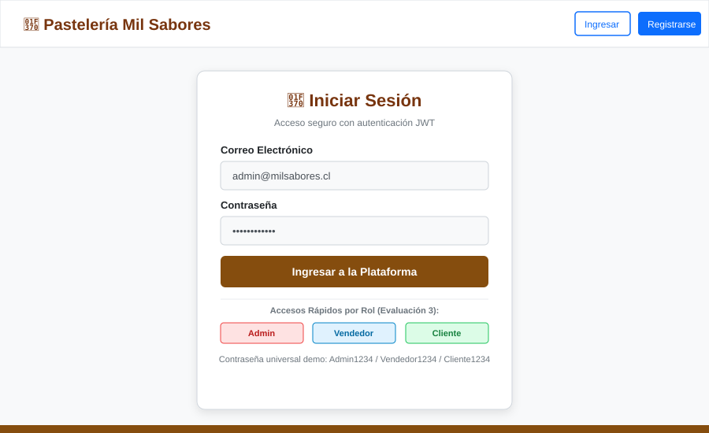
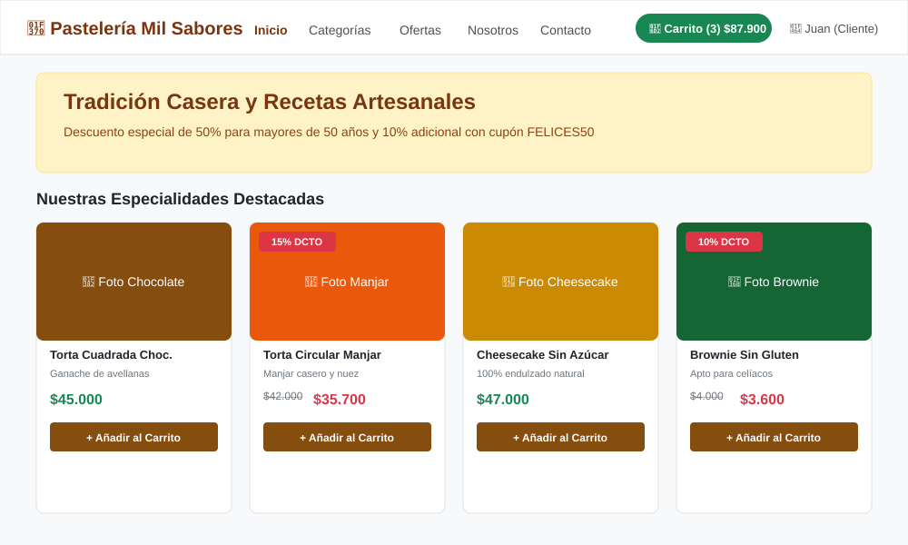
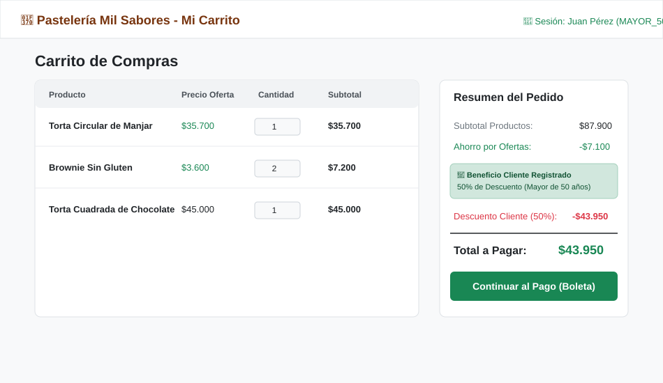
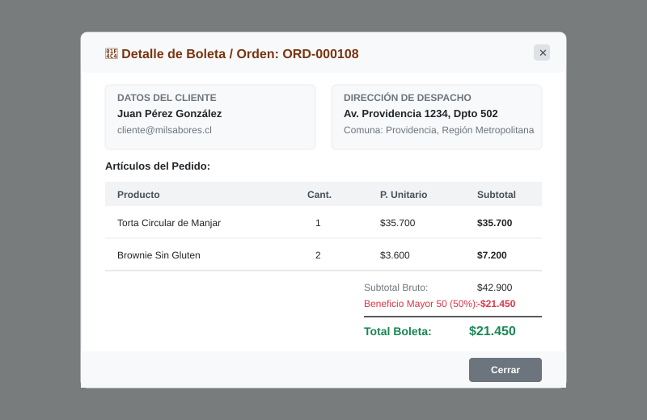
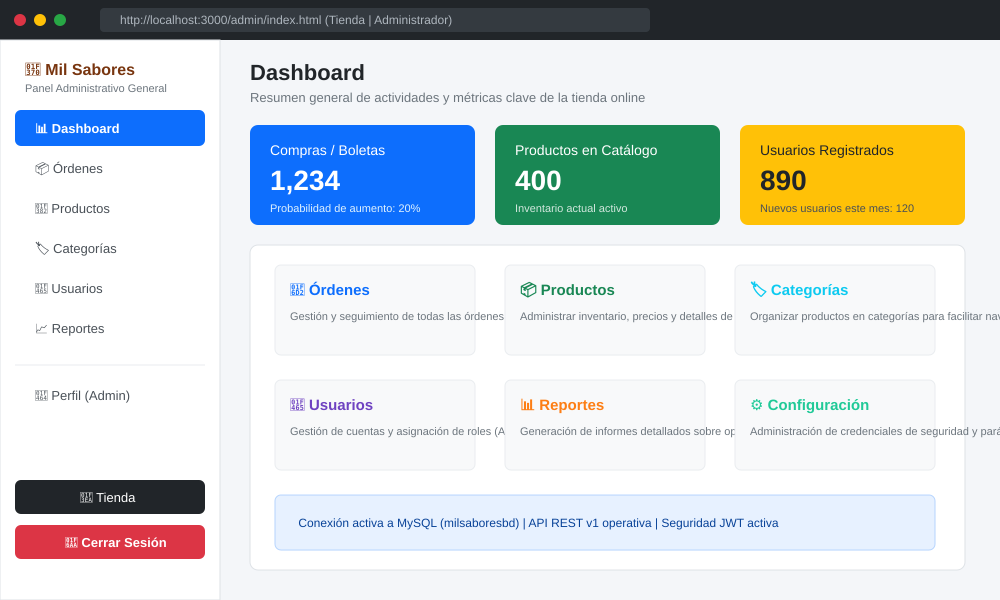
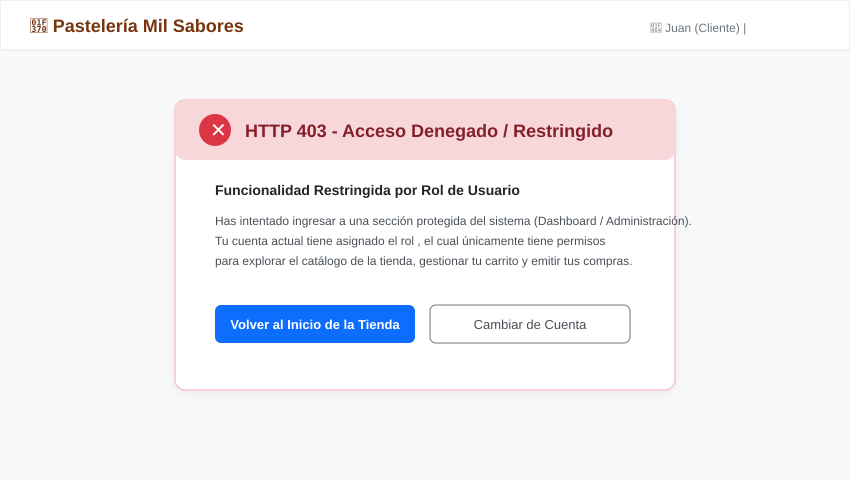
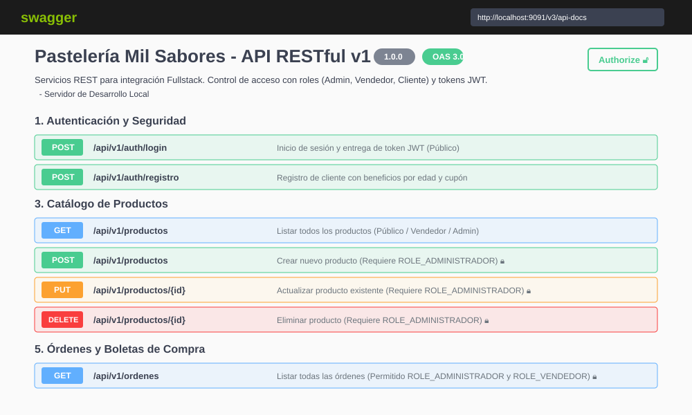
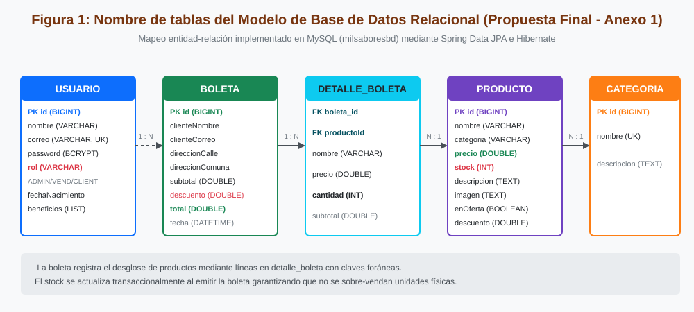

# Manual de Usuario - Pastelería Mil Sabores

**Asignatura:** DSY1104 - Desarrollo Fullstack II  
**Evaluación:** Evaluación Parcial N° 3 (Integrando backend y frontend a la tienda online)  
**Versión del Documento:** 1.0  
**Fecha de Creación:** 12/11/2026  
**Institución:** Duoc UC - Escuela de Informática y Telecomunicaciones  

---

## 1. Introducción

### Propósito del documento
El presente manual tiene como finalidad proporcionar una guía exhaustiva y detallada para la puesta en marcha, navegación y operación integral del sistema web **Pastelería Mil Sabores**. Está dirigido tanto a los usuarios finales (clientes que realizan pedidos en línea) como al personal operativo (vendedores en mostrador) y al administrador del sistema responsable del catálogo, inventario y cuentas de usuario.

### Descripción del sistema
**Pastelería Mil Sabores** es una solución de comercio electrónico fullstack compuesta por:
- Un **frontend desacoplado en React** estructurado bajo componentes con Single Responsibility, estilizado con Bootstrap y enriquecido con lógica de promociones y persistencia de sesión.
- Un **backend RESTful en Spring Boot 3** conectado a una base de datos relacional **MySQL**, asegurado mediante **Spring Security y tokens JWT (JSON Web Tokens)** sin estado (Stateless), con documentación interactiva en **Swagger / OpenAPI 3**.
- Un modelo de seguridad con control de acceso basado en tres roles diferenciados (**Administrador**, **Vendedor** y **Cliente**).

### Cómo usar este manual
Este documento está estructurado de manera progresiva. Para comenzar desde cero, consulte la sección [Requisitos del Sistema](#2-requisitos-del-sistema) e [Instalación y Configuración](#3-instalación-y-configuración). Para el uso diario de las funcionalidades según su perfil de usuario, diríjase a la sección [Uso del Software](#5-uso-del-software).

---

## 2. Requisitos del Sistema

### Hardware necesario

| Componente | Requisito Mínimo | Requisito Recomendado |
| :--- | :--- | :--- |
| **Procesador (CPU)** | Intel Core i3 / AMD Ryzen 3 (2.0 GHz o superior) | Intel Core i5 / AMD Ryzen 5 o superior |
| **Memoria RAM** | 4 GB de memoria RAM libre | 8 GB o superior |
| **Almacenamiento** | 2 GB de espacio libre en disco (SSD recomendado) | 5 GB de espacio libre |
| **Resolución de Pantalla** | 1366 × 768 píxeles | 1920 × 1080 (Full HD) |
| **Conectividad** | Conexión de red local (LAN) o Internet | Acceso a Internet de banda ancha |

### Software necesario

| Software / Dependencia | Versión Compatible | Propósito en la Solución |
| :--- | :--- | :--- |
| **Sistema Operativo** | Windows 10/11, Linux (Ubuntu/Debian) o macOS | Plataforma base de ejecución |
| **Java Development Kit (JDK)** | OpenJDK 17 LTS o 21 LTS | Motor de ejecución del Backend Spring Boot |
| **Apache Maven** | 3.6 o superior (incluido wrapper) | Gestor de compilación y dependencias Java |
| **Node.js** | 20.x o superior (LTS) | Entorno de ejecución para Frontend React |
| **Gestor de Paquetes npm** | 10.x o superior | Instalador de librerías del cliente web |
| **Motor de Base de Datos** | MySQL Server 8.0+ / MariaDB 10.4+ (o H2 en memoria) | Persistencia de datos relacionales |
| **Navegador Web** | Google Chrome, Edge, Firefox o Safari modernos | Renderizado de interfaz cliente y Swagger UI |

---

## 3. Instalación y Configuración

### Instrucciones de instalación paso a paso

#### Paso 1: Configurar la Base de Datos MySQL
1. Inicie su servidor de base de datos MySQL local (por ejemplo a través de XAMPP, MySQL Workbench o servicio nativo en puerto `3306`).
2. Cree la base de datos `milsaboresbd`:
   ```sql
   CREATE DATABASE IF NOT EXISTS milsaboresbd CHARACTER SET utf8mb4 COLLATE utf8mb4_unicode_ci;
   ```
3. Si utiliza credenciales personalizadas, configure las variables de entorno `DB_USER` y `DB_PASSWORD` en su sistema, o edite `backend/src/main/resources/application.properties`. Por defecto, se conecta con usuario `root` y sin contraseña.

#### Paso 2: Despliegue del Backend Spring Boot
1. Abra una terminal en la carpeta `backend/`.
2. Compile y ejecute el servidor con Maven:
   ```bash
   mvn spring-boot:run
   ```
3. El servidor iniciará en el puerto `9091`. Al arrancar por primera vez, el componente `DatosIniciales` poblará automáticamente las tablas `categorias`, `productos` y creará los 3 usuarios base con sus contraseñas encriptadas con **BCrypt**:
   - Administrador: `admin@milsabores.cl` (Clave: `Admin1234`)
   - Vendedor: `vendedor@milsabores.cl` (Clave: `Vendedor1234`)
   - Cliente: `cliente@milsabores.cl` (Clave: `Cliente1234`)
4. Verifique la documentación interactiva Swagger ingresando en su navegador a:  
   `http://localhost:9091/swagger-ui.html`

#### Paso 3: Despliegue del Frontend React
1. Abra una segunda terminal en la carpeta `frontend/`.
2. Instale las dependencias de Node:
   ```bash
   npm install
   ```
3. Inicie el servidor de desarrollo:
   ```bash
   npm start
   ```
4. La aplicación web se abrirá automáticamente en su navegador en `http://localhost:3000`.

---

## 4. Comenzando

### Crear una cuenta / Iniciar sesión

Para interactuar con el sistema, el usuario puede ingresar mediante el botón **"Ingresar"** en la barra superior. La plataforma permite el inicio de sesión mediante credenciales (correo y contraseña) validadas contra la API REST, emitiendo un token **JWT** que se almacena de forma segura en `localStorage` para garantizar la persistencia de la sesión incluso al presionar F5 o recargar la página.

**Figura 1**  
*Pantalla de Autenticación e Inicio de Sesión con Control de Roles*  
<div style="border: 1px solid black; display: inline-block; padding: 2px; margin: 8px 0; background-color: #fff;">
  
</div>  
*Nota: La interfaz valida el correo y la clave encriptada con BCrypt en el backend, devolviendo el token JWT y redirigiendo automáticamente según el rol asignado (Admin al Dashboard, Vendedor a su panel de mostrador y Cliente a la tienda). Ruta: `http://localhost:3000` (vista `login`).*

---

## 5. Uso del Software

### 5.1. Funcionalidades para el Perfil CLIENTE

El cliente cuenta con acceso exclusivo a la tienda online, catálogo comercial, carrito de compras y emisión de boletas con promociones automáticas.

#### A. Catálogo y Navegación de Especialidades
Permite consultar tortas cuadradas, circulares, alternativas sin azúcar y certificadas sin gluten, con sus precios vigentes y distintivos de oferta.

**Figura 5**  
*Catálogo de Productos para Clientes con Indicadores de Oferta*  
<div style="border: 1px solid black; display: inline-block; padding: 2px; margin: 8px 0; background-color: #fff;">
  
</div>  
*Nota: Vista pública accesible por clientes registrados o anónimos. Muestra tarjetas con fotos, ingredientes, precios rebajados en oferta y botón directo para incorporar unidades al pedido. Ruta: `http://localhost:3000` (vista `home`).*

#### B. Carrito de Compras y Aplicación de Reglas de Descuento
El carrito calcula en tiempo real los totales, respetando el tope de existencias físicas en bodega (no permite añadir más unidades de las existentes) y aplicando automáticamente las reglas de negocio del negocio:
1. **Ofertas por producto**: Descuento porcentual individual (ej. 15% en Torta Circular de Manjar, 10% en Brownie).
2. **Beneficio Adulto Mayor (`MAYOR_50`)**: Si el cliente registrado tiene más de 50 años (calculado a partir de su fecha de nacimiento), recibe **50% de descuento** sobre el total de su compra.
3. **Cupón de Bienvenida (`FELICES50`)**: Otorga **10% de descuento vitalicio**.
4. **Regla de no acumulación**: Si el cliente califica para ambos beneficios, el sistema selecciona automáticamente el mayor beneficio (50%) garantizando la mejor tarifa para el cliente sin duplicar rebajas.

**Figura 6**  
*Carrito de Compras con Desglose de Descuentos Comerciales*  
<div style="border: 1px solid black; display: inline-block; padding: 2px; margin: 8px 0; background-color: #fff;">
  
</div>  
*Nota: El carrito totaliza los artículos adquiridos, visualiza la rebaja por beneficio de cliente y habilita el botón para emitir la orden/boleta en la base de datos. Ruta: `http://localhost:3000` (vista `carrito`).*

---

### 5.2. Funcionalidades para el Perfil VENDEDOR

De acuerdo con las instrucciones de la Evaluación Parcial 3 (**Anexo 1**):
> **Vendedor:**  
> - Puede visualizar la lista de los productos y el detalle.  
> - Puede visualizar la lista de órdenes y el detalle.  
> - Todos los demás accesos **no deben aparecer** en la vista del vendedor.

Para dar cumplimiento estricto a este requisito:
1. Al iniciar sesión como vendedor, la barra de navegación muestra el acceso exclusivo **"Panel Vendedor"** y oculta cualquier opción administrativa.
2. En la pestaña de catálogo, el vendedor consulta stock en tiempo real y precios, con el botón **"Ver Detalle"**, pero **no dispone de botones de creación, edición o eliminación de productos**.
3. En la pestaña de órdenes, el vendedor visualiza todas las órdenes emitidas para coordinar despachos y puede hacer clic en **"Ver Boleta"** para examinar el detalle de ítems.
4. Módulos como gestión de categorías, administración de usuarios y balances financieros quedan completamente retirados de su interfaz.

**Figura 3**  
*Panel del Vendedor (Consulta de Catálogo y Órdenes sin Opciones Administrativas)*  
<div style="border: 1px solid black; display: inline-block; padding: 2px; margin: 8px 0; background-color: #fff;">
  
</div>  
*Nota: Panel especializado para el personal de ventas y mostrador. Cumple con la restricción de visibilidad del Anexo 1 al presentar únicamente existencias y órdenes de compra. Ruta: `http://localhost:3000` (vista `vendedor_panel`).*

**Figura 4**  
*Modal de Detalle de Boleta / Orden Consultada por el Vendedor*  
<div style="border: 1px solid black; display: inline-block; padding: 2px; margin: 8px 0; background-color: #fff;">
  
</div>  
*Nota: Al hacer clic en "Ver Boleta", se despliega la información del cliente, dirección exacta de entrega, lista de tortas solicitadas, cantidades y montos aplicados. Ventana modal emergente en `vendedor_panel`.*

---

### 5.3. Funcionalidades para el Perfil ADMINISTRADOR

El Administrador General cuenta con **acceso total** a la plataforma:
- Control de inventario: Creación, actualización y eliminación de tortas y postres (CRUD completo).
- Gestión de categorías de productos.
- Administración y auditoría de cuentas de usuarios y roles.
- Dashboard de métricas con indicadores comerciales y reportes operativos.

**Figura 2**  
*Panel Administrativo General e Inicio de Dashboard*  
<div style="border: 1px solid black; display: inline-block; padding: 2px; margin: 8px 0; background-color: #fff;">
  
</div>  
*Nota: Al entrar como administrador redireccionará al dashboard del administrador, donde mostrará un reporte de métricas clave y accesos directos a todos los módulos. Ruta: `http://localhost:3000` (vista `admin_panel`).*

---

### 5.4. Barrera de Seguridad y Restricciones de Acceso (HTTP 403)

Si un usuario autenticado como Cliente o Vendedor intenta ingresar intencionalmente a una ruta administrativa (por ejemplo `admin_dashboard` o ejecutar operaciones CRUD de catálogo), el frontend detecta la incompatibilidad de rol y bloquea inmediatamente el acceso mostrando una pantalla de advertencia segura sin exponer datos sensibles.

**Figura 7**  
*Pantalla de Control de Acceso y Funcionalidad Restringida por Rol*  
<div style="border: 1px solid black; display: inline-block; padding: 2px; margin: 8px 0; background-color: #fff;">
  
</div>  
*Nota: Mensaje informativo de restricción de permisos. Permite al usuario regresar a su entorno autorizado o alternar de cuenta según corresponda.*

---

### 5.5. Documentación Interactiva con Swagger UI

Los desarrolladores y evaluadores pueden probar interactivamente todos los endpoints del backend utilizando la interfaz de Swagger UI.

**Figura 8**  
*Interfaz Interactiva de Swagger UI / OpenAPI 3 con Autenticación Bearer JWT*  
<div style="border: 1px solid black; display: inline-block; padding: 2px; margin: 8px 0; background-color: #fff;">
  
</div>  
*Nota: Swagger UI expone los endpoints organizados por tags, esquemas de entrada/salida y permite ingresar el token JWT en el botón "Authorize" para probar endpoints privados. Ruta: `http://localhost:9091/swagger-ui.html`.*

---

## 6. Modelo de Datos Relacional Implementado

El sistema implementa en su totalidad la arquitectura de datos relacional establecida en la **Figura 1 del Anexo 1**:
$$\text{USUARIO} \longleftrightarrow \text{BOLETA} \longleftrightarrow \text{DETALLE\_BOLETA} \longleftrightarrow \text{PRODUCTO} \longleftrightarrow \text{CATEGORIA}$$

**Figura 9**  
*Diagrama Entidad-Relación de la Base de Datos Relacional (Propuesta Final Anexo 1)*  
<div style="border: 1px solid black; display: inline-block; padding: 2px; margin: 8px 0; background-color: #fff;">
  
</div>  
*Nota: Estructura de tablas implementada en MySQL (`milsaboresbd`) mediante Spring Data JPA. Registra boletas tributarias y pedidos asegurando integridad referencial y actualización automática de existencias.*

---

## 7. Preguntas Frecuentes y Soporte

1. **¿Qué ocurre si recargo la página (F5)?**  
   La sesión no se pierde. El frontend recupera automáticamente el token JWT y el perfil seguro desde `localStorage`, manteniendo al usuario conectado en su respectivo rol.
2. **¿Cómo se cierran todas las credenciales de forma segura?**  
   Haciendo clic en el botón **"Salir"** en la barra de navegación. Esto destruye el token en memoria y en `localStorage`, devolviendo la aplicación al estado público.
3. **¿Qué credenciales demo puedo utilizar para evaluar los 3 roles?**  
   - Administrador: `admin@milsabores.cl` / `Admin1234`
   - Vendedor: `vendedor@milsabores.cl` / `Vendedor1234`
   - Cliente: `cliente@milsabores.cl` / `Cliente1234`

